> **Auto-generated** from the case dictionaries, solver logs and `postproc/out/` by `tools/make_case_reports.py`. Do not edit by hand: re-run the generator.
> Canonical project documents: [`report/report.pdf`](../../report/report.pdf), [`docs/vv_report.md`](../../docs/vv_report.md), [`explains_methodology.md`](../../explains_methodology.md).

## Scoring map (15-point assessment)

| criterion | points | where in this document |
|---|---|---|
| Problem description and mathematical formulation | 3 | sections 1 and 2 |
| Dimensional analysis | 2 | section 3 |
| Numerical methodology and expected accuracy | 4 | section 4 |
| Computational setup | 2 | section 5 |
| Preliminary results, verification, critical analysis | 4 | section 6 |

## 1. Problem description and motivation

This case is a **static verification** of the two-phase solver on the dip geometry. The liquid pool is initialised in exact hydrostatic equilibrium and both inlets are closed (zero prescribed velocity), so the exact solution is: velocity identically zero, pressure hydrostatic in each phase, and a flat liquid/gas interface. Any non-zero velocity or pressure drift is a numerical artefact and is measured here.

Motivation: before trusting a dynamic slugging simulation, the same mesh and scheme must reproduce a state that should not move. This separates discretisation errors (spurious currents at the density jump, pressure-velocity decoupling) from physical dynamics.

Role in the project: V4 (hydrostatic pressure) and V5 (spurious currents).


**References:** [1]--[13] at the end of this report (terrain-slugging literature, VOF/CSF methods, error estimation and the OpenFOAM-14 documentation).

## 2. Mathematical formulation

### 2.1 Governing equations

The solver is OpenFOAM-14 `compressibleVoF`, run by `foamRun`. Unknowns are one velocity $\mathbf U$, pressure $p$, temperature $T$ and the liquid fraction $\alpha_l$ (`0/alpha.oil`, $\alpha_g=1-\alpha_l$), with $\rho=\alpha_l\rho_l+\alpha_g\rho_g$, $\mu=\alpha_l\mu_l+\alpha_g\mu_g$, $\rho_g=p/(R_gT)$ (perfect gas) and $\rho_l$ constant (`rhoConst`):


$$
\begin{aligned}
\partial_t \rho + \nabla\cdot(\rho\mathbf U) &= 0,\\
\partial_t(\alpha_l\rho_l)+\nabla\cdot(\alpha_l\rho_l\mathbf U)
+\nabla\cdot(\alpha_l\alpha_g\rho_l\mathbf U_r) &= S_\alpha,\\
\partial_t(\rho\mathbf U)+\nabla\cdot(\rho\mathbf U\mathbf U)
&= -\nabla p+\rho\mathbf g+\nabla\cdot\boldsymbol\tau+\sigma\kappa\nabla\alpha_l,\\
\partial_t(\rho e)+\nabla\cdot(\rho\mathbf U e)+\partial_t(\rho K)+\nabla\cdot(\rho\mathbf U K)
&= \nabla\cdot(\alpha_{eff}\nabla T),
\end{aligned}
$$

with the interface-compression velocity $\mathbf U_r=c_\alpha|\mathbf U|\hat{\mathbf n}$, $c_\alpha=1$, $\hat{\mathbf n}=\nabla\alpha_l/|\nabla\alpha_l|$, the curvature $\kappa=-\nabla\cdot\hat{\mathbf n}$ of the CSF model and the compressibility source $S_\alpha$. The energy equation is what makes the gas response close to adiabatic (the isothermal twin case removes it).

### 2.2 Modelling assumptions

* Inlets closed (velocity fixed to zero), outlet pressure fixed: no forced throughflow.
* Initial pressure is hydrostatic in the liquid: `p_rgh = p0 + (rho_l - rho_g) g y_s`; a uniform p_rgh would introduce a spurious 1.3 kPa step at the interface.
* Surface tension is active in the baseline; the sigma = 0 twin (separate case) isolates the capillary contribution to the parasitic current.
* Laminar; no turbulence model. Density ratio 750:1 and viscosity ratio 1.1e4:1 as in production.

### 2.3 Initial and boundary conditions

Boundary-condition **types** parsed from the generated `0/` dictionaries:

| patch | U | p_rgh | alpha.oil | T | p |
|---|---|---|---|---|---|
| inletLiquid | fixedValue | fixedFluxPressure | fixedValue | fixedValue | calculated |
| inletGas | fixedValue | fixedFluxPressure | fixedValue | fixedValue | calculated |
| outlet | pressureInletOutletVelocity | fixedValue | inletOutlet | inletOutlet | calculated |
| walls | noSlip | fixedFluxPressure | zeroGradient | zeroGradient | calculated |
| frontAndBack | empty | empty | empty | empty | empty |

| type | meaning |
|---|---|
| `fixedValue` | impose the value (velocity, phase fraction, temperature, or the pressure level at the outlet) |
| `fixedFluxPressure` | adjust the pressure so the mass flux matches the velocity BC (walls and velocity inlets) |
| `pressureInletOutletVelocity` | zero velocity unless the flow wants to enter, then it follows the pressure |
| `inletOutlet` | zero gradient for outflow, fixed inlet value for backflow |
| `calculated` | recomputed from other fields (p = p_rgh + rho*gh) |
| `zeroGradient` | no normal gradient (adiabatic wall for T) |
| `noSlip` | zero velocity at the wall |
| `empty` | 2D constraint: the solution does not vary through this direction |

Initial condition (`system/setFieldsDict`):

```
defaultValues
{
    alpha.oil     0;
    p_rgh       100000;
}

zones
{
    // horizontal free surface at y = 0.15 m: liquid below, gas above
    pool
    {
        type        box;
        box         (-1e300 -1e300 -1e300) (1e300 0.15 1e300);
        values
        {
            alpha.oil     1;
            p_rgh       101322.5842;
        }
    }
}
```

The liquid is initialised with the exact hydrostatic `p_rgh` (`p_rgh = p0 + (rho_l - rho_g) g y_s`) instead of a uniform value, which makes the initial state static to round-off in the liquid and is what the V4 check measures.

## 3. Dimensional analysis

### 3.1 Length and grid scales

| scale | definition | value | significance |
|---|---|---|---|
| diameter / gap D | given | 0.05 m | pipe diameter, also the grid scale |
| vertical height H | D/cos(theta) | 0.05019 m | 2D planar channel height |
| total length L | 2 x 3 m | 6 m | L/D = 120 |
| dip depth dz | L_leg sin(theta) | 0.2615 m | sets the hydrostatic head rho_l g dz = 2.308 kPa |
| grid spacing | D/n | 5.000 mm | D/dx = 10 |
| vertical spacing | H/n | 5.019 mm | 10 cells across H |
| capillary length | sqrt(sigma/(Delta rho g)) | 1.84 mm | below grid scale: capillarity under-resolved |

### 3.2 Time scales

| scale | definition | value | significance |
|---|---|---|---|
| advective | D/(J_L+J_G) | 0.07143 s | cell-crossing time |
| system transit | L/(J_L+J_G) | 8.571 s | through-flow time |
| leg transit | L_leg/J_G | 6 s | gas displacement time |
| acoustic transit | L/c | 0.01749 s | pressure equilibration (c = 343.1 m/s) |
| gas compression | L_leg/J_G | 6 s | time to compress the trapped gas |
| viscous diffusion (oil) | D^2/nu_l | 11.25 s | momentum diffusion across the channel |
| viscous film | h^2/nu_l | 1.012 s | h = 0.3 D inlet layer |
| tilted U-tube | 2 pi sqrt(L/(2 g sin theta)) | 11.77 s | gravity-wave scale of the liquid column |
| simulated time | endTime | 5 s | see results for how many cycles |

### 3.3 Dimensionless groups

| group | definition | value | physical significance |
|---|---|---|---|
| Re_sl | rho_l J_L D/mu_l | 45.0 | liquid superficial Reynolds: laminar |
| Re_sg | rho_g J_G D/mu_g | 1666.7 | gas superficial Reynolds: at the laminar/transitional edge |
| Re_g,local | rho_g U_g D/mu_g | 2381 | in-situ gas Reynolds just above 2300 (assumption: laminar) |
| Fr_m | (J_L+J_G)/sqrt(gD) | 0.9995 | inertia vs gravity; Fr ~ 1 |
| Eo | Delta rho g D^2/sigma | 734.8 | gravity dominates capillarity by ~700 |
| We_g | rho_g J_G^2 D/sigma | 0.5 | gas inertia vs capillarity (weak) |
| rho_l/rho_g | - | 750 | density ratio: the hard VOF number |
| mu_l/mu_g | - | 11111 | viscosity ratio |
| rho_l g dz/p0 | - | 0.02308 | compression parameter: 2.3 % (compressibility matters) |
| L/D | - | 120 | slug length 12-30 D fits 4-10 times |
| l_c/D | - | 0.03689 | capillary length / gap |

### 3.4 Interpretation

The liquid is laminar (`Re_sl = 45`); the gas sits at the laminar/transitional edge (`Re_g,local ~ 2.4e3`), which is an assumption. `Eo ~ 735` means gravity dominates surface tension by nearly three orders of magnitude, so the interface shape is gravity-controlled and the ~10 % Laplace bias is a weak error. `Fr_m ~ 1` means inertia and gravity are comparable, so neither can be neglected. The **compression parameter `rho_l g dz/p0 = 2.3 %`** is the key number for this problem: it is small enough that the flow looks almost incompressible, but large enough that the dip stores a measurable gas pressure - which is exactly why the compressible-VOF model is needed. The density ratio 750 is what makes the VOF interface and the pressure-gradient balance numerically hard (hence V5).

## 4. Numerical methodology and expected accuracy

### 4.1 Discretisation


The solver is OpenFOAM-14 `compressibleVoF`, run by `foamRun`. It uses the **finite-volume method**
on a structured hexahedral mesh. For a conserved quantity $\phi$ in control volume $V_P$ with
faces $f$,

$$
\int_{V_P}\partial_t\phi\,dV + \oint_{\partial V_P}\mathbf F\cdot d\mathbf A
= \int_{V_P}S\,dV
\quad\Longrightarrow\quad
\partial_t(\phi_P V_P) + \sum_f F_f A_f = S_P V_P ,
$$

with the face flux $F_f = \mathbf U_f\cdot\mathbf n_f$ evaluated by linear (central) interpolation
and the face value $\phi_f$ by the selected convection scheme:

* **first-order upwind** (used for $\mathbf U$ and $T$): $\phi_f = \phi_{UP}$ - stable but
  numerically diffusive ($\mathcal O(h)$ on smooth fields);
* **linear/central** for gradients and the pressure term - second order on smooth fields;
* **interface compression** for the phase fraction: a flux $\alpha_l\alpha_g\mathbf U_r$ with
  $\mathbf U_r = c_\alpha|\mathbf U|\hat{\mathbf n}$, $c_\alpha=1$, $\hat{\mathbf n}=\nabla\alpha_l/|\nabla\alpha_l|$,
  which sharpens the interface while preserving boundedness.

*Time*: first-order implicit Euler, $\phi^{n+1}=\phi^n+\Delta t\,f(\phi^{n+1})$, with the time step
controlled by `adjustTimeStep` and the Courant number

$$
\mathrm{Co} = \max_f \frac{|\phi_f|\Delta t}{V_P} \le 0.5,\qquad
\mathrm{Co}_\alpha = \max_f \frac{|\phi_{\alpha,f}|\Delta t}{V_P} \le 0.5 .
$$

The phase fraction is advanced with **MULES**: an explicit flux-limited update

$$
\alpha_P^{n+1} = \alpha_P^{n} - \frac{\Delta t}{V_P}\sum_f \lambda_f F_{\alpha,f},
\qquad \lambda_f \in [0,1],
$$

where the limiter $\lambda_f$ is chosen so that $0\le\alpha\le1$; `nSubCycles` sub-cycles keep
$\mathrm{Co}_\alpha\le 0.5$. The pressure-velocity coupling is **PIMPLE** (a merged PISO/SIMPLE):
after the momentum equation the pressure correction $p'$ solves
$\nabla\cdot\left(A_p^{-1}\nabla p'\right) = \nabla\cdot\mathbf U^* + \text{compressibility source}$,
the velocity is corrected as $\mathbf U=\mathbf U^* - A_p^{-1}\nabla p'$, and the loop is repeated
`nOuterCorrectors` times. For compressible flow the continuity equation carries the density
compressibility $\psi=\partial\rho/\partial p = 1/(R_gT)$, which is how the dip stores gas pressure.

*Expected accuracy*: second order in space for smooth fields (central terms), first order in time
(Euler), and **first order for the interface position** because the VOF interface is 1-2 cells
thick; the effective order of the global pressure history is therefore $\approx 1$--$2$ and is
quantified by the GCI where a repeatable signal exists.


### 4.2 Solver controls

| setting | value |
|---|---|
| solver | compressibleVoF |
| time scheme | Euler |
| alpha convection | Gauss interfaceCompression vanLeer 1 |
| U convection | Gauss upwind |
| nOuterCorrectors / nCorrectors | 2 / 1 |
| MULES nSubCycles / nIter | 2 / 5 |
| maxCo / maxAlphaCo | 0.5 / 0.5 |
| maxDeltaT [s] | 0.01 |
| endTime [s] / writeInterval [s] | 5 / 0.25 |
| function objects | probes, interfaceHeight1, totalMass, maxU, massIn, massOut, pOutlet |

### 4.3 Expected accuracy and error sources

* Spatial: formally second order for the central terms, **first order for U and T** (upwind), and first order for the interface position because the VOF interface is 1-2 cells thick.
* Temporal: first-order Euler; the time step is capped by `Co <= 0.5` and `Co_alpha <= 0.5`, so the temporal error is expected to be small but is **not yet quantified** for cycle quantities (V11 pending).
* Linear-solver error: pressure tolerance 1e-8 (relative), velocity/alpha tight tolerances; the solver converges every time step (`nOuterCorrectors` PIMPLE loops).
* Modelling errors dominate the numerical ones: laminar assumption for a transitional gas, CSF curvature bias (~10 % on the Laplace jump), and the 2D planar/duct idealisation.

## 5. Computational setup

### 5.1 Geometry and mesh

| item | value |
|---|---|
| domain | L = 6 m, D = 0.05 m, dip depth 0.2615 m, 5 deg |
| cells | 12000 |
| D/dx | 10 |
| grid spacing | - |
| 2D/3D | 2D planar (empty front/back) |

Mesh quality (from `log.checkMesh`, where available): `Mesh OK`; the dip mesh has maximum non-orthogonality 4.98 deg (the 5 deg leg skew), maximum aspect ratio 1.09-1.14 and minimum cell volume 2.51e-7 m^3 for D/dx = 10.

### 5.2 Boundary conditions

See section 2.3 for the patch/field matrix and the initial condition; the exact numeric values are in `cases/dip2D_hydrostatic_n10/0/`.

### 5.3 Hardware and cost

| run | time steps | ExecutionTime [s] | core-h per sim-second |
|---|---|---|---|
| `s2_hydro_60s` | 6045 | 555 | 0.002569 |
| `s2_hydrostatic_long` | 2045 | 174 | 0.002422 |
| `s2_hydrostatic_n10` | 545 | 37 | 0.002035 |
| `s2_hydrostatic_n10b` | 545 | 52 | 0.002903 |

All runs on one core of a 12-core, 22 GB machine (serial is faster than MPI at these mesh sizes).

## 6. Preliminary results, verification and critical analysis

### 6.1 Runs and quantitative results

Summary of the runs associated with this case:


| run | status | t_last [s] | record [s] | T peaks [s] | T FFT [s] | dp [Pa] | mass cum. err |
|---|---|---|---|---|---|---|---|
| `s2_hydro_60s` | finished | 60.000 | 60.000 | - | - | - | n/a |
| `s2_hydrostatic_long` | finished | 20.000 | 20.000 | - | - | - | n/a |
| `s2_hydrostatic_n10` | finished | 5.000 | 5.000 | - | - | - | n/a |
| `s2_hydrostatic_n10b` | finished | 5.000 | 5.000 | - | - | - | n/a |


### Run `s2_hydro_60s`


Status: **finished**; last simulated time 60.000 s.


| metric | value |
|---|---|
| record length [s] | 60.000 |
| transient end [s] | 30.000 |
| transient flag | transient_not_detected |
| period from peaks [s] | - |
| period from FFT [s] | - |
| dp amplitude [Pa] | - |
| dp global range [Pa] | 0.0 |
| p_up min / max [Pa] | 99996.9 / 99996.9 |
| n cycles used | - |
| n slugs detected | n/a (static case) |
| core-hours | 0.169 |

Mass balance: **n/a** (no throughflow / hydrostatic case).

> transient not detected (transient_not_detected); period/dp are not yet statistically converged

> pressure signal: p_up; 1201 samples from 0.000 to 60.000 s

> holdup x-t field: 1201 times x 31 stations

> mass balance: no-flow/hydrostatic case (inlet/outlet mass flows are numerical zero) -- check not applicable


Numerical details parsed from the solver log:


| quantity | value |
|---|---|
| time steps | 6045 |
| dt min / median / max [ms] | 1.1962 / 10.0000 / 10.0000 |
| max Co / max Co_alpha | 0.57 / 0.57 |
| min / max alpha.oil | -1.3e-15 / 1.000000 |
| solver ExecutionTime [s] | 555 |
| core-hours per simulated second | 0.002569 |


Extracted data (under `runs/s2_hydro_60s/extracted/`):


| file | rows | time span |
|---|---|---|
| holdup.csv | 37231 | 0.000->60.000 s |
| holdup_stations.csv | 31 |  |
| mass.csv | 1201 | 0.000->60.000 s |
| massflow.csv | 1201 | 0.000->60.000 s |
| maxU.csv | 1201 | 0.000->60.000 s |
| p_time.csv | 1201 | 0.000->60.000 s |
| probe_T.csv | 1201 | 0.000->60.000 s |
| probe_U.csv | 1201 | 0.000->60.000 s |
| probe_alpha_oil.csv | 1201 | 0.000->60.000 s |


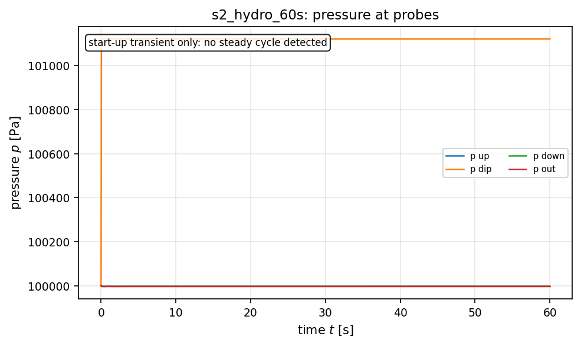


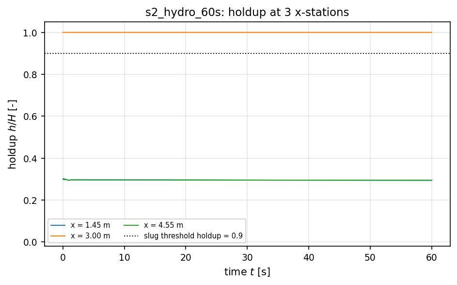


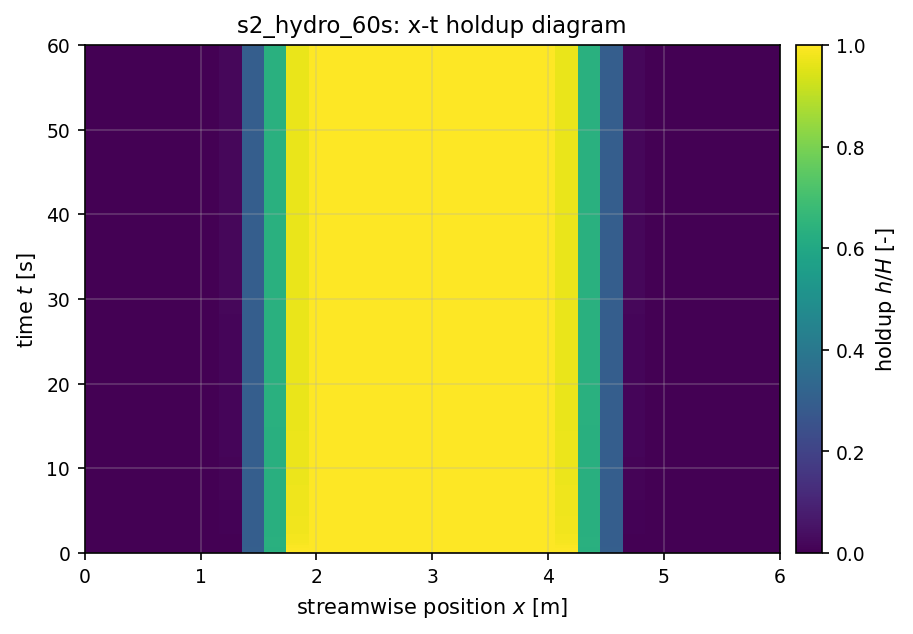


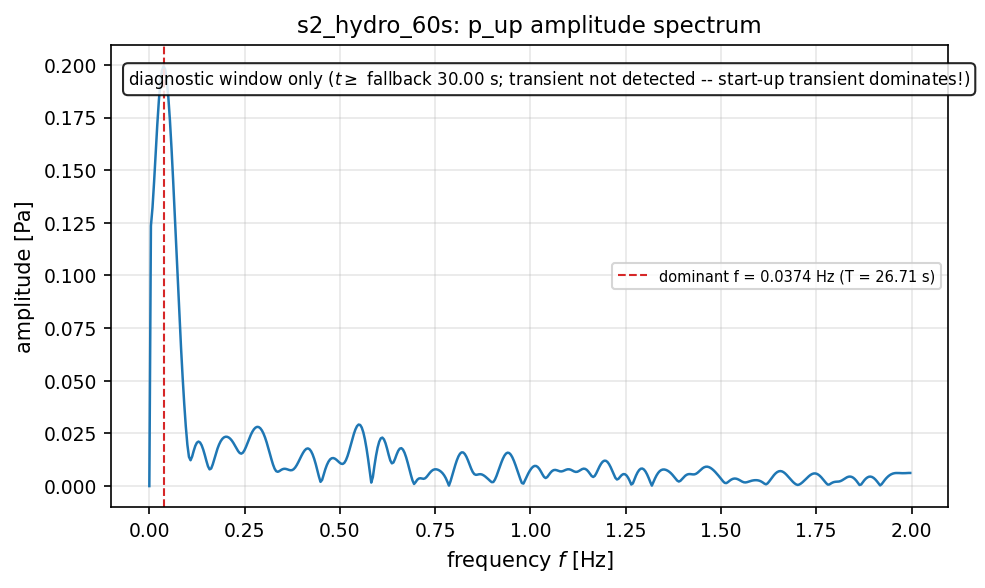


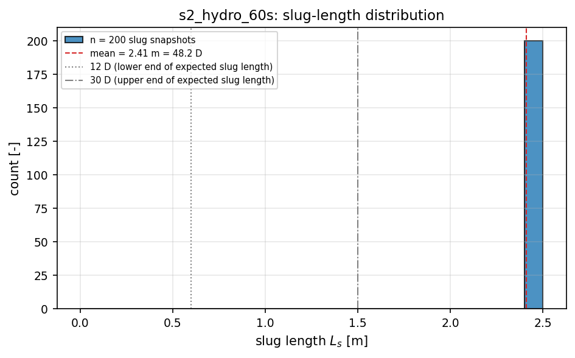


### Run `s2_hydrostatic_long`


Status: **finished**; last simulated time 20.000 s.


| metric | value |
|---|---|
| record length [s] | 20.000 |
| transient end [s] | 10.000 |
| transient flag | transient_not_detected |
| period from peaks [s] | - |
| period from FFT [s] | - |
| dp amplitude [Pa] | - |
| dp global range [Pa] | 0.0 |
| p_up min / max [Pa] | 99996.9 / 99996.9 |
| n cycles used | - |
| n slugs detected | n/a (static case) |
| core-hours | 0.049 |

Mass balance: **n/a** (no throughflow / hydrostatic case).

> transient not detected (transient_not_detected); period/dp are not yet statistically converged

> pressure signal: p_up; 401 samples from 0.000 to 20.000 s

> holdup x-t field: 401 times x 31 stations

> mass balance: no-flow/hydrostatic case (inlet/outlet mass flows are numerical zero) -- check not applicable


Numerical details parsed from the solver log:


| quantity | value |
|---|---|
| time steps | 2045 |
| dt min / median / max [ms] | 1.1962 / 10.0000 / 10.0000 |
| max Co / max Co_alpha | 0.57 / 0.57 |
| min / max alpha.oil | -7.5e-21 / 1.000000 |
| solver ExecutionTime [s] | 174 |
| core-hours per simulated second | 0.002422 |


Extracted data (under `runs/s2_hydrostatic_long/extracted/`):


| file | rows | time span |
|---|---|---|
| holdup.csv | 12431 | 0.000->20.000 s |
| holdup_stations.csv | 31 |  |
| mass.csv | 401 | 0.000->20.000 s |
| massflow.csv | 401 | 0.000->20.000 s |
| maxU.csv | 401 | 0.000->20.000 s |
| p_time.csv | 401 | 0.000->20.000 s |
| probe_T.csv | 401 | 0.000->20.000 s |
| probe_U.csv | 401 | 0.000->20.000 s |
| probe_alpha_oil.csv | 401 | 0.000->20.000 s |


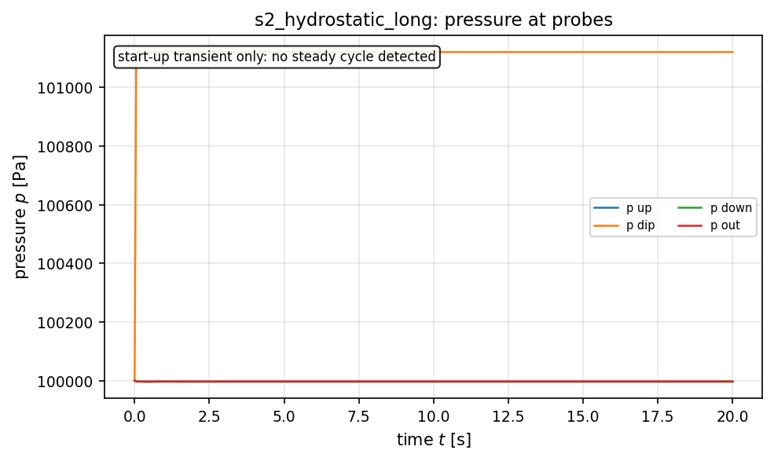


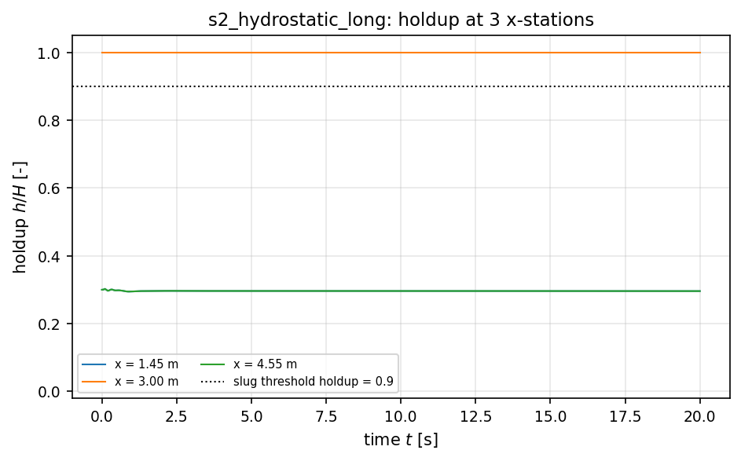


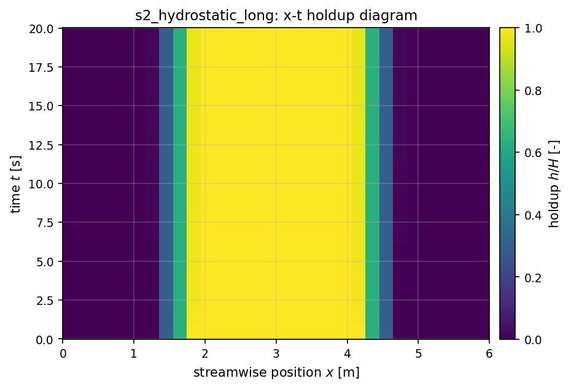


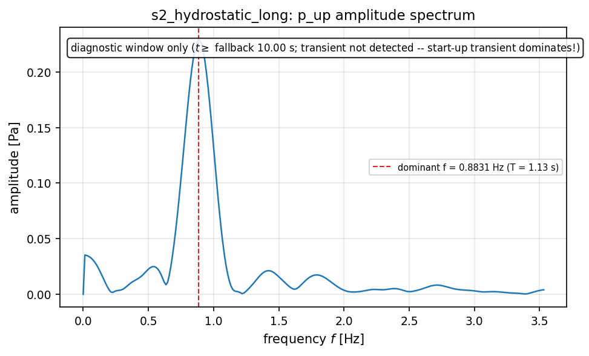


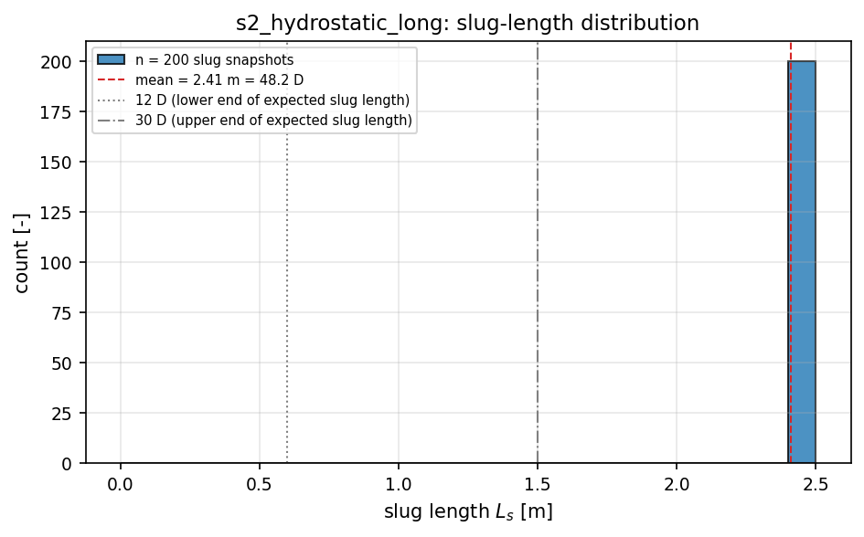


### Run `s2_hydrostatic_n10`


Status: **finished**; last simulated time 5.000 s.


| metric | value |
|---|---|
| record length [s] | 5.000 |
| transient end [s] | 2.500 |
| transient flag | transient_not_detected |
| period from peaks [s] | - |
| period from FFT [s] | - |
| dp amplitude [Pa] | - |
| dp global range [Pa] | 0.2 |
| p_up min / max [Pa] | 99996.8 / 99997.0 |
| n cycles used | - |
| n slugs detected | n/a (static case) |
| core-hours | 0.010 |

Mass balance: **n/a** (no throughflow / hydrostatic case).

> transient not detected (transient_not_detected); period/dp are not yet statistically converged

> pressure signal: p_up; 101 samples from 0.000 to 5.000 s

> holdup x-t field: 101 times x 31 stations

> mass balance: no-flow/hydrostatic case (inlet/outlet mass flows are numerical zero) -- check not applicable


Numerical details parsed from the solver log:


| quantity | value |
|---|---|
| time steps | 545 |
| dt min / median / max [ms] | 1.1962 / 10.0000 / 10.0000 |
| max Co / max Co_alpha | 0.57 / 0.57 |
| min / max alpha.oil | -2.7e-20 / 1.000000 |
| solver ExecutionTime [s] | 37 |
| core-hours per simulated second | 0.002035 |


Extracted data (under `runs/s2_hydrostatic_n10/extracted/`):


| file | rows | time span |
|---|---|---|
| holdup.csv | 3131 | 0.000->5.000 s |
| holdup_stations.csv | 31 |  |
| mass.csv | 101 | 0.000->5.000 s |
| massflow.csv | 101 | 0.000->5.000 s |
| p_time.csv | 101 | 0.000->5.000 s |
| probe_T.csv | 101 | 0.000->5.000 s |
| probe_U.csv | 101 | 0.000->5.000 s |
| probe_alpha_oil.csv | 101 | 0.000->5.000 s |


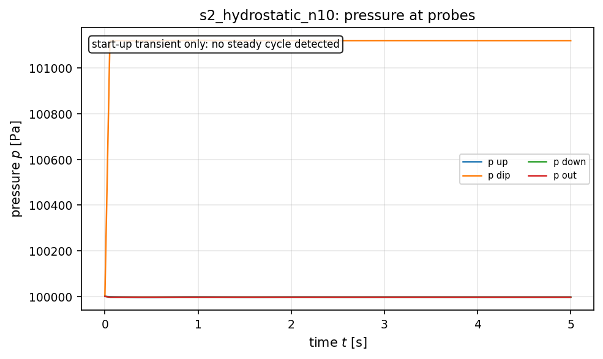


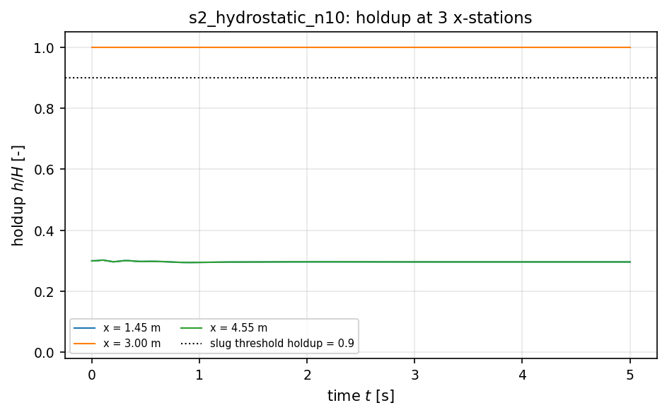


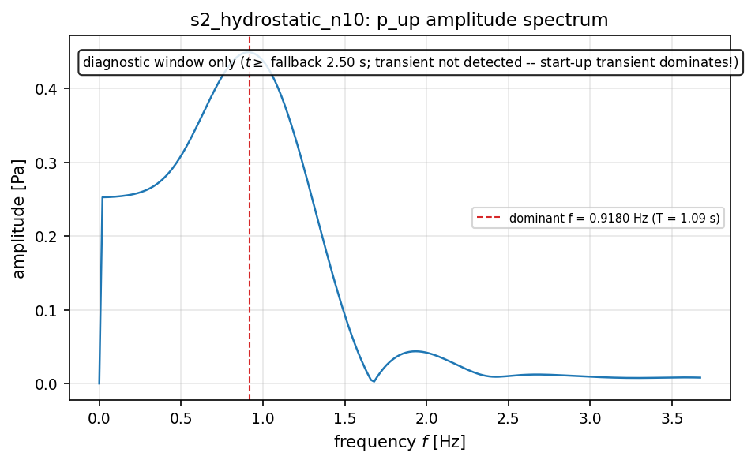


### Run `s2_hydrostatic_n10b`


Status: **finished**; last simulated time 5.000 s.


| metric | value |
|---|---|
| record length [s] | 5.000 |
| transient end [s] | 2.500 |
| transient flag | transient_not_detected |
| period from peaks [s] | - |
| period from FFT [s] | - |
| dp amplitude [Pa] | - |
| dp global range [Pa] | 0.2 |
| p_up min / max [Pa] | 99996.8 / 99997.0 |
| n cycles used | - |
| n slugs detected | n/a (static case) |
| core-hours | 0.014 |

Mass balance: **n/a** (no throughflow / hydrostatic case).

> transient not detected (transient_not_detected); period/dp are not yet statistically converged

> pressure signal: p_up; 101 samples from 0.000 to 5.000 s

> holdup x-t field: 101 times x 31 stations

> mass balance: no-flow/hydrostatic case (inlet/outlet mass flows are numerical zero) -- check not applicable


Numerical details parsed from the solver log:


| quantity | value |
|---|---|
| time steps | 545 |
| dt min / median / max [ms] | 1.1962 / 10.0000 / 10.0000 |
| max Co / max Co_alpha | 0.57 / 0.57 |
| min / max alpha.oil | -2.7e-20 / 1.000000 |
| solver ExecutionTime [s] | 52 |
| core-hours per simulated second | 0.002903 |


Extracted data (under `runs/s2_hydrostatic_n10b/extracted/`):


| file | rows | time span |
|---|---|---|
| holdup.csv | 3131 | 0.000->5.000 s |
| holdup_stations.csv | 31 |  |
| mass.csv | 101 | 0.000->5.000 s |
| massflow.csv | 101 | 0.000->5.000 s |
| maxU.csv | 101 | 0.000->5.000 s |
| p_time.csv | 101 | 0.000->5.000 s |
| probe_T.csv | 101 | 0.000->5.000 s |
| probe_U.csv | 101 | 0.000->5.000 s |
| probe_alpha_oil.csv | 101 | 0.000->5.000 s |


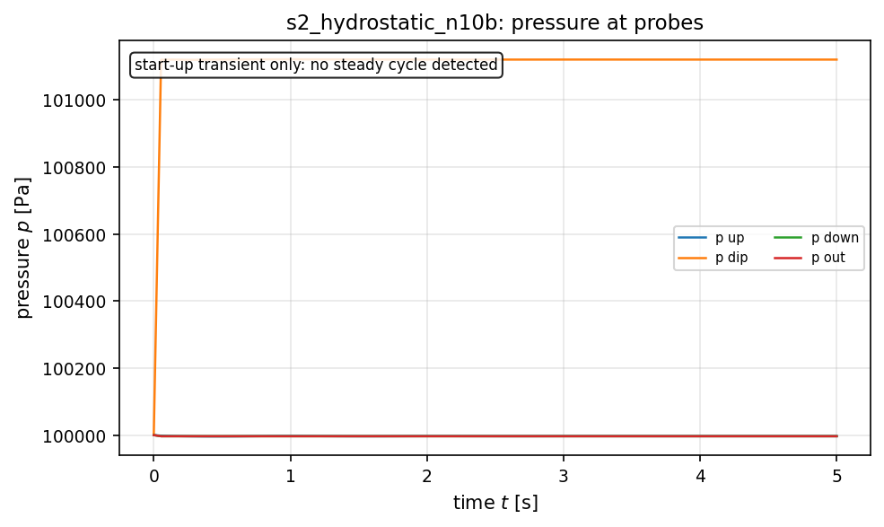


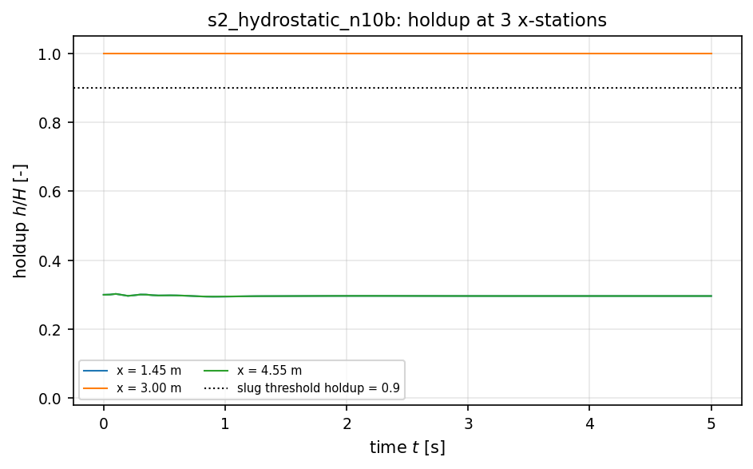


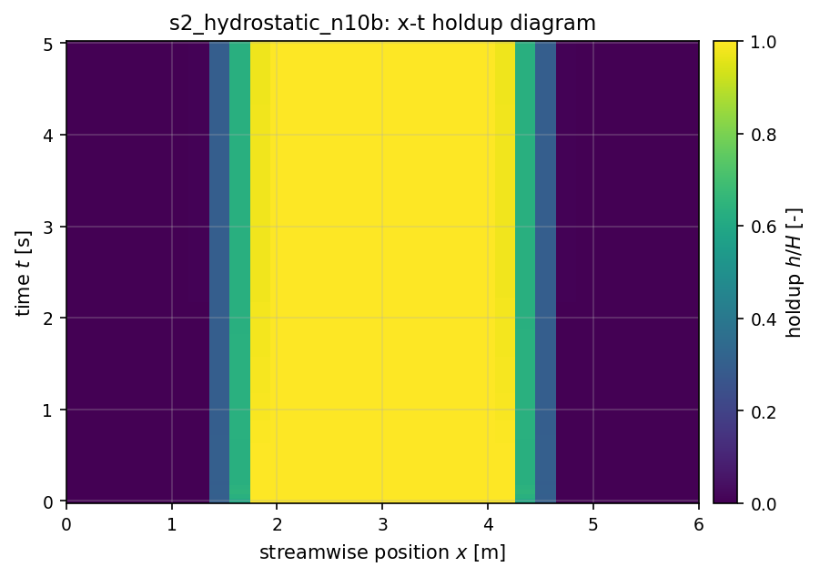


### 6.2 Verification and validation relevant to this case

| test | criterion / reference | result | status |
|---|---|---|---|
| V4 | hydrostatic pressure vs analytic rho g h | see results | PASS |
| V5 | spurious current max\|U\| < 1 % J_G | see results | FAIL (diagnosed) |

Full V&V matrix: [`docs/vv_report.md`](../../docs/vv_report.md). Status definitions: **PASS** = quantitative agreement within the stated tolerance; **PARTIAL** = agreement with a known, quantified bias/limitation; **FAIL** = criterion not met but diagnosed and reported; **NOT DONE** = not affordable/available, with the reason.

### 6.3 Convergence studies

No mesh study is complete for the spurious current: n = 10 gives about 0.040 m/s and n = 20 about 0.038 m/s (the `dip2D_hydrostatic_n20` case), i.e. the parasitic current does not decrease with refinement. The sigma = 0 control (`dip2D_hydrostatic_nosigma_n10`) gives the same order, which proves the current is not capillary. The pressure itself is mesh-insensitive to 0.01 %. See `docs/vv_report.md` V4-V5.

### 6.4 Critical analysis and limitations

* The model is **2D planar**, not axisymmetric or a circular pipe: holdup and slug length are comparable to a pipe, the interface height and the pressure are not. The 2D results must not be used to predict a real pipe at this D.
* The strict spurious-current criterion (`max|U| < 1 % J_G`) is **not met**: a parasitic current of ~8 % J_G persists at all tested resolutions. It is not capillary and does not decay, but it is only ~0.6 % of the dynamic gas velocities during the release, so it does not affect the cycle metrics. See V5.
* The gas is close to adiabatic in the baseline; the isothermal twin bounds the thermodynamic model-form uncertainty to about 1 % on the start-up peak and <0.1 % later (V15).
* The gas in-situ Reynolds number is ~2.4e3 (transitional edge) and the model is laminar: this is an assumption, not a resolved turbulence effect.

### 6.5 What can and cannot be concluded

**Can:** the solver reproduces the hydrostatic state and the start-up pressure release to within the GCI; compressibility changes the start-up peak by ~1.2 %; the dip at this operating point shows weak aperiodic pressure oscillations rather than a converged slugging cycle (see the main report). **Cannot:** claim a validated slugging period/amplitude, claim 3D pipe behaviour from 2D planar data, or claim cycle-resolved grid convergence (V10) and time-step independence (V11) - both are documented as not done.

## 7. Reproduction instructions

### 7.1 Software environment and dependencies

* **OpenFOAM-14** (Foundation build, openfoam.org), solver `foamRun -solver compressibleVoF`, case generated with git `aef427a`.
* Linux, bash; OpenMPI only for `NPROC > 1` (serial is faster at these mesh sizes).
* Python 3.10+ with `numpy`, `pandas`, `matplotlib`, `pyyaml` (project pipeline).
* `pandoc` + `latexmk`/`pdflatex` only to rebuild this report.
* Environment: `source /opt/openfoam14/etc/bashrc`.

### 7.2 Step-by-step

1. Generate the case from the single source of truth: `python3 tools/gen_case.py dip2D_hydrostatic_n10 --force`.
2. Run it in place: `cd cases/dip2D_hydrostatic_n10 && ./Allclean && ./Allrun` (or `NPROC=12 ./Allrun`), or through the project pipeline below.
3. Pipeline (recommended, keeps the template clean):

```bash
./scripts/new_run.sh dip2D_hydrostatic_n10 <run-name> <endTime> 1
python3 tools/extract.py runs/<run-name>
python3 postproc/metrics.py runs/<run-name> --out postproc/out --summary-csv
python3 postproc/plots.py runs/<run-name>
python3 run_all.py
python3 tools/make_case_reports.py --cases dip2D_hydrostatic_n10
```

4. Post-process to VTK: `cd runs/<run-name> && source /opt/openfoam14/etc/bashrc && foamToVTK -latestTime`, then open `VTK/*.vtk` in ParaView (colour by `alpha.oil` for the interface).

### 7.3 Known manual steps / environment quirks

* MPI: `/dev/shm` is blocked in some sandboxes; `Allrun` and `new_run.sh` point vader at `$PWD/.mpi_shm`. TCP is ~20x slower.
* `setFields` in OpenFOAM-14 uses the `defaultValues`/`zones` syntax; the older syntax silently selects zero cells (check the liquid volume fraction in the solver log).
* `fixedTemperature` is incompatible with `compressibleVoF` in v14; the isothermal limit uses `Cp_g = 1e9`.
* Runs longer than a few hours are resumed with `./scripts/continue_run.sh`; check `run.pid`.

## 8. Automation

| script | what it does | notes |
|---|---|---|
| `Allrun` | blockMesh (if needed) + setFields (if present) + checkMesh + foamRun | serial by default; `NPROC=12 ./Allrun` for MPI; `--continue` restarts |
| `Allclean` | removes written times except `0/`, `postProcessing/`, `VTK/`, logs, `polyMesh` | idempotent; keeps the setup |
| `run.sh` | in-place run with metadata recording (case key, OpenFOAM version, git hash) | used when you want a self-contained case run |
| `scripts/new_run.sh` | copies the template to `runs/<run>`, launches, records PID/logs | the pipeline used for all reported results |

Full automation is possible: `python3 tools/make_case_reports.py` regenerates this report and `python3 run_all.py` regenerates all metrics/figures from the runs. Long simulations are the only manual part (start/stop/resume).

## 9. Repository hygiene and organization

* Simulation results are **not committed**: `.gitignore` excludes `runs/`, `cases/*/[0-9]*/`, `cases/*/postProcessing/`, `cases/*/VTK/`, `cases/*/log.*`, `constant/polyMesh`, and LaTeX build artefacts.
* This case directory contains only inputs: `0/`, `constant/`, `system/`, `Allrun`, `Allclean`, `run.sh`, `meta.json`, this README.
* All inputs are reproducible from `params/params.yaml` + `tools/gen_case.py` (or `tools/gen_extra.py`); the generator is the single source of truth.
* Layout: `params/` inputs | `cases/` templates | `runs/` results (ignored) | `tools/`, `postproc/` Python | `oned/` 1D solver | `scripts/` drivers | `report/` reports | `docs/` | `figures/` | `data/`.

## 10. File index

| path | content |
|---|---|
| `cases/dip2D_hydrostatic_n10/` | OpenFOAM case template (inputs only) |
| `cases/dip2D_hydrostatic_n10/0/` | initial and boundary conditions |
| `cases/dip2D_hydrostatic_n10/constant/` | g, momentumTransport, phaseProperties, physicalProperties.* |
| `cases/dip2D_hydrostatic_n10/system/` | blockMeshDict, controlDict, fvSchemes, fvSolution, functions, setFieldsDict |
| `cases/dip2D_hydrostatic_n10/Allrun`, `Allclean` | automation scripts |
| `report/dip2D_hydrostatic_n10/README.md` | this file |
| `report/dip2D_hydrostatic_n10/report.pdf` | compiled PDF of this file |
| `runs/s2_hydro_60s/` | solver logs, time directories, postProcessing, extracted CSVs |
| `runs/s2_hydrostatic_long/` | solver logs, time directories, postProcessing, extracted CSVs |
| `runs/s2_hydrostatic_n10/` | solver logs, time directories, postProcessing, extracted CSVs |
| `runs/s2_hydrostatic_n10b/` | solver logs, time directories, postProcessing, extracted CSVs |

## References

[1] Schmidt, Z., Brill, J.P., Beggs, H.D. (1980). Experimental study of severe slugging in a two-phase-flow pipeline-riser pipe system. *SPE J.* 20(5), 407-414.
[2] Taitel, Y. (1986). Stability of severe slugging. *Int. J. Multiphase Flow* 12(2), 203-217.
[3] de Henau, V., Raithby, G.D. (1995a). A transient two-fluid model for the simulation of slug flow in pipelines - I. Theory. *Int. J. Multiphase Flow* 21(3), 335-349.
[4] de Henau, V., Raithby, G.D. (1995b). A transient two-fluid model for the simulation of slug flow in pipelines - II. Validation. *Int. J. Multiphase Flow* 21(3), 351-363.
[5] de Henau, V., Raithby, G.D. (1995c). A study of terrain-induced slugging in two-phase flow pipelines. *Int. J. Multiphase Flow* 21(3), 365-379.
[6] Zuber, N., Findlay, J.A. (1965). Average volumetric concentration in two-phase flow systems. *J. Heat Transfer* 87(4), 453-468.
[7] Bendiksen, K.H. (1984). The dynamics of long gas bubbles in inclined tubes. *Int. J. Multiphase Flow* 10(4), 467-483.
[8] Hirt, C.W., Nichols, B.D. (1981). Volume of fluid (VOF) method for the dynamics of free boundaries. *J. Comput. Phys.* 39, 201-225.
[9] Brackbill, J.U., Kothe, D.B., Zemach, C. (1992). A continuum method for modeling surface tension. *J. Comput. Phys.* 100, 335-354.
[10] Rusche, H. (2002). *Computational fluid dynamics of dispersed two-phase flows at high phase fractions*. PhD thesis, Imperial College London.
[11] Issa, R.I. (1986). Solution of the implicitly discretised fluid flow equations by operator-splitting. *J. Comput. Phys.* 62, 40-65.
[12] Celik, I.B., Ghia, U., Roache, P.J., Freitas, C.J., Coleman, H., Raad, P.E. (2008). Procedure for estimation and reporting of uncertainty due to discretization in CFD applications. *J. Fluids Eng.* 130(7), 078001.
[13] OpenFOAM Foundation (2026). OpenFOAM-14, https://openfoam.org/v14 (solver module `compressibleVoF`).

